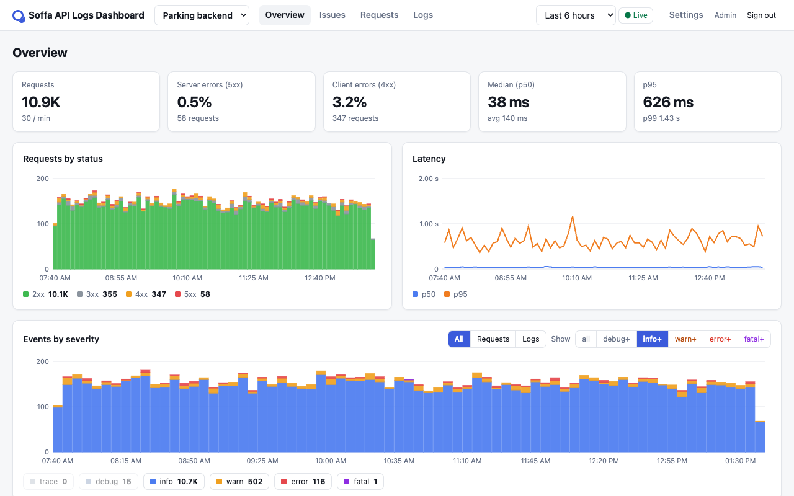
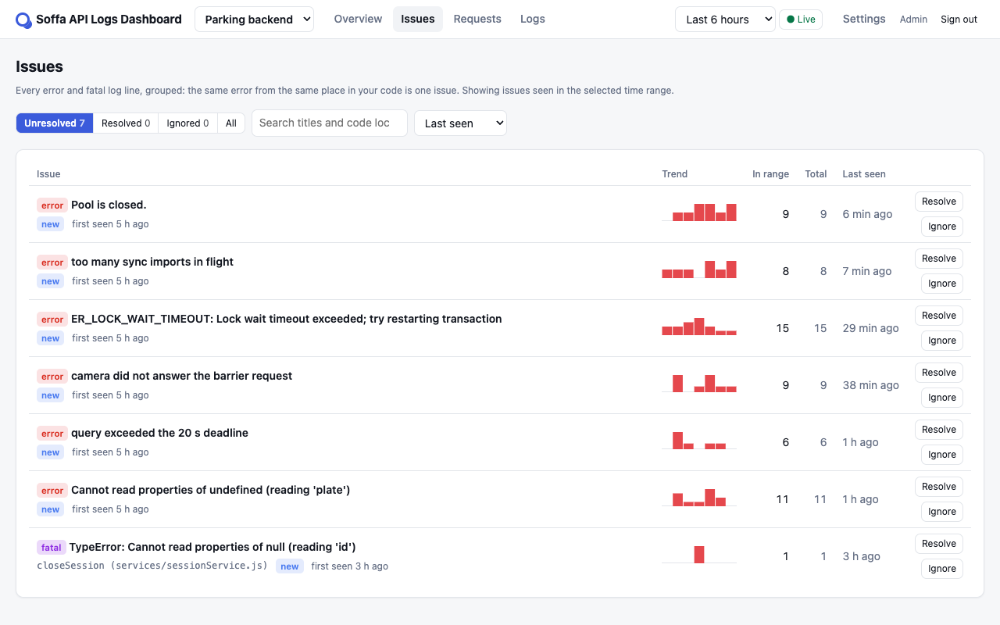
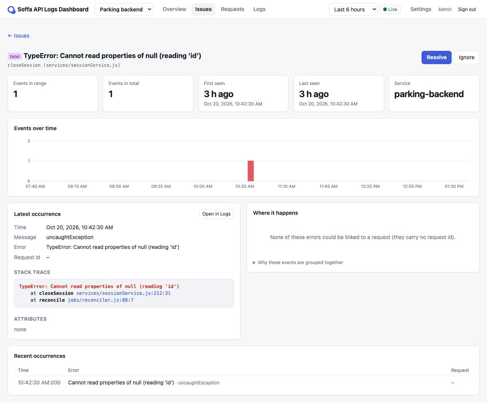
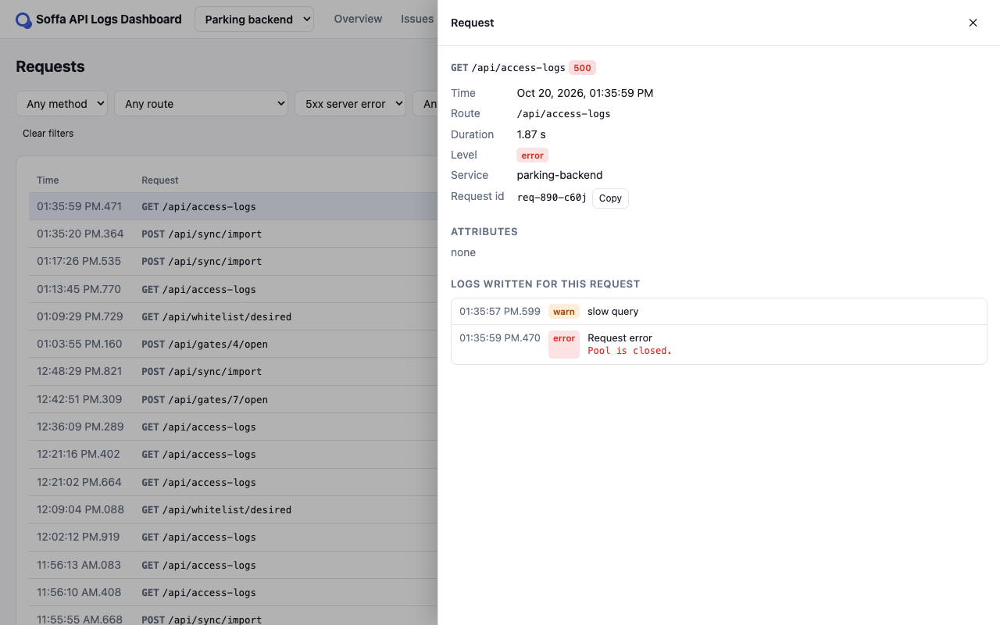

# Soffa API Logs Dashboard

**Self-hosted dashboard for your API's requests and errors.** See request
volume, latency and status codes, slice everything by severity with one
"show this level and above" control, follow a failed request to the log lines
and stack trace it produced, and get identical errors folded into issues you
can resolve.

The project was called apiloupe at first, and its repository, packages,
commands and settings keep that name (`@apiloupe/node`, `apiloupe-import`,
`APILOUPE_*`), so existing installs and integrations carry on unchanged.



- **Overview:** requests per minute, 4xx and 5xx rates, p50 / p95 / p99
  latency, requests by status over time, and the busiest routes.
- **Severity:** every event counted by level (trace → fatal), with a verbosity
  control that hides everything below the level you pick.
- **Issues:** every error grouped with the ones like it (same error, same
  place in your code), with a trend line, the routes it hits, and resolve /
  ignore. A resolved issue that comes back reopens as a regression.
- **Requests and logs:** filter and search both, open a request to see every
  log line written while serving it, open an error to see its stack trace with
  your own code highlighted, or watch new lines arrive with **live tail**.
- **Three ways in:** a Node.js SDK (Express middleware and a pino stream), an
  importer for the JSON logs you already have (files, pipes, AWS CloudWatch
  Logs), and a plain HTTP API.
- **Self-hosted and private by default:** one container and Postgres. Request
  bodies, query strings, headers and IPs are dropped unless you ask for them,
  and passwords, tokens and card numbers are masked before anything is stored.

| Issues                                 | An issue                                                     | A failed request and its logs                                |
| -------------------------------------- | ------------------------------------------------------------ | ------------------------------------------------------------ |
|  |  |  |

## Quick start

Requirements: Docker with Compose.

```sh
git clone https://github.com/emaalouf/apiloupe.git
cd apiloupe
docker compose up -d
docker compose logs app | grep 'setup code'
```

Open <http://localhost:8080>, enter the setup code from the log and create the
first admin, then a project and an ingest key (the dashboard walks you
through it). To see it with data straight away:

```sh
docker compose exec app apiloupe-import --demo 360 --key alk_...
```

**On a server:** [deploy/ec2](deploy/ec2) launches the dashboard on a small AWS
instance with one command, HTTPS and nightly backups included. Anywhere else,
run the image `ghcr.io/emaalouf/apiloupe` behind a TLS proxy, with
`DATABASE_URL` pointing at Postgres 15 or newer and `PUBLIC_URL` set to its
https address.

## Sending data

### From a Node.js app

[`@apiloupe/node`](packages/sdk-node) has no dependencies and works with
CommonJS and ESM:

```js
const { createApiloupe } = require('@apiloupe/node');
const apiloupe = createApiloupe({
  endpoint: process.env.APILOUPE_ENDPOINT,
  key: process.env.APILOUPE_KEY,
});

app.use(apiloupe.express()); // every request
const logger = pino(
  opts,
  pino.multistream([
    { stream: process.stdout },
    { stream: apiloupe.pinoStream({ requests: false }) }, // every log line
  ]),
);
```

It never throws into your app, costs microseconds per request, keeps its
queue bounded when the dashboard is down, and does nothing until both settings
are present. For busy apps, `sampleRate: 0.1` sends a tenth of the successful
requests and routine logs (never errors or warnings) and the dashboard scales
the counts back up. [examples/express-pino](examples/express-pino) is a
complete app.

### Existing logs

`apiloupe-import` reads JSON log lines (pino, pino-http, bunyan and most JSON
loggers) from files, gzipped or not, or from standard input:

```sh
apiloupe-import --endpoint https://apiloupe.example.com --key alk_... app.log app.log.1.gz
kubectl logs deploy/api | apiloupe-import --key alk_...
```

A line with a method, a path and a status code becomes a **request**; any
other line a **log** event, with its error and stack trace. Importing the same
lines twice stores them once, and lines the SDK already shipped live are the
same events. `--dry-run` shows what would be sent. The Docker image includes
the importer; from a clone, run `pnpm import-logs …`.

### From AWS CloudWatch Logs

```sh
apiloupe-import --key alk_... --cloudwatch --log-group /ecs/my-api \
  --stream-prefix api --region eu-central-1 --since 14d
```

It uses the same credentials as the `aws` CLI, reads in one-hour windows and
saves its place after each window the server has accepted, so an interrupted
import resumes where it stopped. `--follow` keeps importing new logs. The
credentials need `logs:FilterLogEvents` on the log group:

```json
{
  "Version": "2012-10-17",
  "Statement": [
    {
      "Effect": "Allow",
      "Action": "logs:FilterLogEvents",
      "Resource": "arn:aws:logs:eu-central-1:123456789012:log-group:/ecs/my-api:*"
    }
  ]
}
```

### Anything else

Post events to the [ingest API](docs/ingest-api.md):

```sh
curl -X POST https://apiloupe.example.com/ingest/v1/events \
  -H 'Authorization: Bearer alk_...' -H 'Content-Type: application/json' \
  -d '{"events":[{"type":"log","time":"2026-10-20T12:00:00Z","level":"error","message":"payment failed","requestId":"r-42"}]}'
```

## Configuration

| Variable                   | Default    | Meaning                                                                   |
| -------------------------- | ---------- | ------------------------------------------------------------------------- |
| `DATABASE_URL`             | required   | Postgres connection string. Postgres 15 or newer.                         |
| `PORT`                     | `8080`     | HTTP port.                                                                |
| `HOST`                     | `0.0.0.0`  | Interface to listen on.                                                   |
| `PUBLIC_URL`               | none       | The dashboard's public address. When https: HSTS and Secure cookies.      |
| `TRUST_PROXY`              | `false`    | Trust `X-Forwarded-*` from a reverse proxy (for client IPs and https).    |
| `RETENTION_DAYS`           | `14`       | Days of events kept. Older days are dropped a whole partition at a time.  |
| `SETUP_CODE`               | random     | The first-run setup code. When unset, a random one is printed in the log. |
| `INGEST_EVENTS_PER_SECOND` | `10000`    | Rate limit per ingest key; bursts of five seconds' worth are allowed.     |
| `INGEST_CONCURRENCY`       | `4`        | Batches written at once; more queue, and past the queue senders get 503.  |
| `MAX_ROUTES_PER_PROJECT`   | `1000`     | Distinct routes per project; further routes are counted as `(other)`.     |
| `LOG_LEVEL`                | `info`     | The server's own log level.                                               |
| `PUBLIC_DIR`               | `./public` | Where the built dashboard is served from (set by the Docker image).       |

## Accounts and security

The first admin is created in the browser with the setup code from the server
log, so whoever reaches a fresh server first cannot claim it. Admins invite
people from **Settings → Users** with a one-time link (the dashboard sends
no email). Members see every project and can resolve and ignore issues; admins
also manage projects, keys and users.

```sh
echo 'a long password' | apiloupe-server create-admin --email you@example.com
echo 'a new password'  | apiloupe-server reset-password --email you@example.com
apiloupe-server reprocess-issues            # regroup stored errors into issues
```

Passwords are hashed with scrypt; sessions are HttpOnly, SameSite=Strict
cookies, and state changes also need a same-origin `Origin` header. Sign-in is
rate-limited per address and per email. Ingest keys and session tokens are
stored only as SHA-256 hashes. The dashboard runs under a strict content
security policy (nothing from other origins, no inline scripts or styles), and
the browser tests fail on any violation. Report vulnerabilities as described
in [SECURITY.md](SECURITY.md).

## Development

Requirements: Node.js 22+ and Corepack (bundled with Node).

```sh
corepack enable
pnpm install
cp .env.example .env
pnpm db:up          # Postgres in Docker, on localhost:5433
pnpm dev            # server on :8080, dashboard on :5173
pnpm demo --key alk_...
pnpm lint && pnpm typecheck && pnpm test
pnpm build && pnpm test:e2e    # browser tests (Playwright)
```

| Package             | Contents                                                       |
| ------------------- | -------------------------------------------------------------- |
| `packages/shared`   | Event format, levels, log lines, grouping, sampling, redaction |
| `packages/server`   | Ingest API, dashboard API, accounts, and host for the built UI |
| `packages/ui`       | The dashboard (React + Vite)                                   |
| `packages/importer` | `apiloupe-import`: files, pipes and CloudWatch Logs            |
| `packages/sdk-node` | `@apiloupe/node`: Express middleware and pino stream           |
| `e2e`               | Browser tests and the README's screenshots                     |
| `examples/*`        | Small apps wired to the dashboard                              |
| `deploy/ec2`        | One-command deployment on AWS                                  |

[docs/architecture.md](docs/architecture.md) explains how the pieces fit;
[CONTRIBUTING.md](CONTRIBUTING.md) how to work on them.

## License

[MIT](LICENSE)
